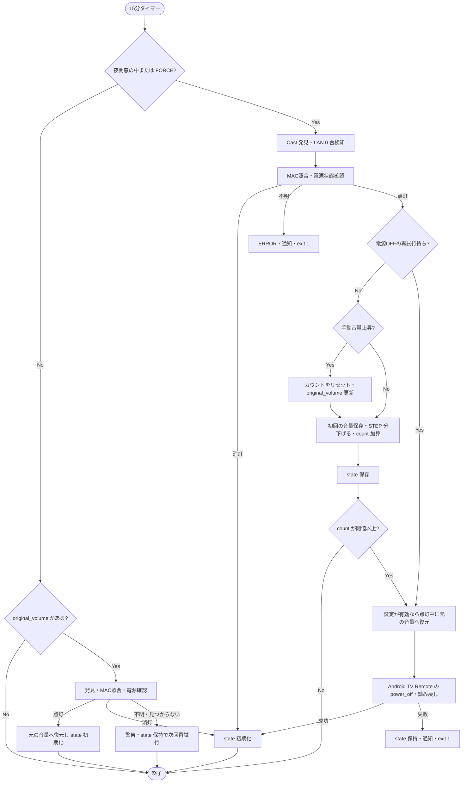

# ねむキャス (Nemucast) 🔊😴

Google TV を夜中に見ながら寝落ちした時に、音量を段階的に下げてテレビ本体の電源を切るツールです。

自動制御はローカル時刻の 00:30〜05:00 だけ。手動の音量上昇で待ち時間を数え直し、電源を切る直前に元の音量へ戻します。20:00 に即切るタイマーも併用できます。


## 🎯 機能

- **活動判定を state で保持**: `last_auto_volume` と `inactive_streak` を JSON に保存します
- **手動上昇を検出**: 前回の自動設定音量より上がっていれば活動ありとみなします
- **定期実行にも連続実行にも対応**: 1回だけの tick 実行と、standby まで継続する session 実行の両方をサポートします
- **夜間だけ自動制御**: 昼間・夕方の視聴には触れず、夜間は電源状態を確認してから音量を操作します
- **2 つの運用を同時に動かす**: 20:00 の即 OFF（`nemucast-standby`）と、深夜の段階的 OFF（`nemucast-auto`）。別々の periodic-worker タスクです

## 📋 必要な環境

- Python 3.11 以上
- 同一ネットワーク上に Chromecast / Google TV デバイス
- `uv`

## 🚀 インストール

```bash
git clone https://github.com/noricha-vr/nemucast.git
cd nemucast
uv sync
cp .env.example .env
```

## ⚙️ 基本設定

| 環境変数 | 説明 | デフォルト |
|---------|------|-----------|
| `CHROMECAST_NAME` | 通常実行時の対象デバイス名 | `"Dell"` |
| `STEP` | 1回で下げる音量幅 | `-0.04` |
| `MIN_LEVEL` | これ以上は下げない最小音量 | `0.3` |
| `INTERVAL_SEC` | 定期実行の想定間隔 | `1200` |
| `INACTIVE_THRESHOLD` | 連続非アクティブ回数のしきい値 | `3` |
| `MANUAL_RISE_THRESHOLD` | 手動上昇とみなす最小差分 | `0.01` |
| `STATE_FILE` | state JSON の保存先 | `logs/activity_state.json` |
| `STATE_STALE_INTERVAL_MULTIPLIER` | state を古いとみなす倍率 | `2` |
| `RUN_UNTIL_STANDBY` | standby まで interval ごとに継続実行するか | `0` |

state は `INTERVAL_SEC x STATE_STALE_INTERVAL_MULTIPLIER` より古いと破棄されます。

## 📖 使い方

### 1回だけ判定する通常実行

```bash
uv run nemucast
uv run nemucast --interval 900 --inactive-threshold 4
```

### standby まで継続する実行

```bash
uv run nemucast --interval 900 --inactive-threshold 4 --run-until-standby
```

## 🕘 タイマー用プロファイル

### テレビの電源を切る

- コマンド: `nemucast-standby`
- 動き:
  - Cast の発見結果から IP を得て（mDNS に出ない時は同じ名前で最後に見えた IP）、Android TV Remote v2 でテレビ本体の電源を切ります
  - POWER キーはトグルなので、`is_on` を読んで点いている時だけ送り、新規接続で `is_on=False` を読み戻して確認します（切れなければ最大 `TV_POWER_MAX_ATTEMPTS` 回）。元から切れていれば何も送らず成功です
  - 見つからない・接続できない・切れない時は終了コード 1 と `DISCOVERY_ALERT_COMMAND` の通知
  - 音量は触りません。state ファイルも使いません
- 初回ペアリング（1 回だけ）: `nemucast-tv-pair --pin-file <PIN を書くファイル> --need-file <PIN 要求を書くファイル>`。テレビに出た PIN を `--pin-file` に書くと完了し、証明書・鍵を `TV_CERT_DIR`（既定 `~/.config/nemucast`、0600）に保存します
- 環境変数: `TV_CERT_DIR`（既定 `~/.config/nemucast`）/ `TV_POWER_KEY`（既定 `POWER`）/ `TV_POWER_WAIT_SEC`（既定 10）/ `TV_POWER_MAX_ATTEMPTS`（既定 3）
- オプション:
  - `--name`: 対象デバイス名（デフォルト: `CHROMECAST_NAME` 環境変数 / `Dell`）
- 想定用途: 「20:00 になったら即切る」のような時刻指定の電源OFF

### 自動寝かしつけ（夜間のみ）

- コマンド: `uv run --frozen nemucast-auto`
- periodic-worker は従来どおり 15 分間隔で 24 時間起動します。制御する時間はローカル時刻の **00:30 以上、05:00 未満** です。
- 旧 00:30 プロファイルの「深夜に音量を下げながら待ち、手動で上げたら数え直す」という考え方を引き継ぎました。昼間と 20:00 までの視聴には触りません。20:00 の即時 OFF は別タスクです。

1. 時間外はネットワークに触れず終了します。例外は進行中セッションの後始末だけで、発見・MAC 照合・電源状態の確認後、点灯中なら元の音量に戻し、消灯中なら音量に触れず state を初期化します。確認できなければ警告して次 tick で再試行します。
2. 夜間は Cast を発見し、保存済み MAC と照合して Android TV Remote の `is_on` を先に読みます。消灯中なら音量にも POWER にも触れず state を初期化します。状態不明・MAC 未登録/不一致・接続不可なら操作せず終了コード 1 と通知です。初回は `nemucast-tv-pair` でペアリングしてください。
3. 点灯中だけ音量を `STEP` ずつ下げます。最初の音量を `original_volume` に保存します。前回の設定値より手動で音量が上がったら、連続カウントをリセットし、元の音量もその値に更新します。
4. 下限 `AUTO_MIN_LEVEL` 以下なら音量を変えずカウントだけ進めます。既定では **3 回目の tick で閾値に達し、その tick 内で電源を切ります**（00:30 に開始すれば 00:45、01:00 と進み、01:00 に OFF）。
5. 切る直前、**テレビがまだ点いている間に** `original_volume` へ音量を戻し、Android TV Remote の `power_off` を実行します。POWER は `is_on=True` の時だけ送り、新規接続で OFF を読み戻します。`quit_app` は使いません。翌日の音量が小さいままになるのを防ぎます。
6. OFF を確認できたら state を初期化します。失敗時はカウントと元の音量を保持し、`DISCOVERY_ALERT_COMMAND` へ通知して終了コード 1。次 tick は音量復元を手動上昇と誤認せず、電源状態を再確認して OFF を再試行します。

| 環境変数 | 説明 | 既定値 |
|----------|------|--------|
| `AUTO_NIGHT_START` | 夜間窓の開始（ローカル時刻 HH:MM、含む） | `00:30` |
| `AUTO_NIGHT_END` | 夜間窓の終了（HH:MM、含まない）。`23:00`〜`02:00` のような日付またぎにも対応。同時刻は空の窓 | `05:00` |
| `AUTO_NIGHT_FORCE` | `1` なら時間帯を無視して動作。昼間の試験用 | `0` |
| `AUTO_RESTORE_VOLUME` | `1` なら電源 OFF 直前に元の音量へ戻す。時間外の後始末ではこの設定にかかわらず戻す | `1` |
| `AUTO_RESTORE_WAIT_SEC` | 音量復元後、テレビが反映した値を読み戻して確かめる待ち時間（秒）。`set_volume` は応答を待たず、反映前に電源を切ると翌日の音量が 0 になった（実機）ため、確認してから電源を切る。確認できなくても電源OFFは続行し WARNING を出す | `5` |
| `AUTO_RESTORE_TOLERANCE` | 読み戻しの許容差 | `0.015` |
| `AUTO_LOWERED_THRESHOLD` | 電源 OFF までの連続下げ回数 | `3` |
| `AUTO_MIN_LEVEL` | 下限音量 | `0.05` |
| `AUTO_STATE_FILE` | 自動制御の state 保存先 | `logs/auto_standby_state.json` |
| `AUTO_STATE_STALE_SEC` | 間隔が空いた時に連続カウントを捨てる秒数 | `1800` |
| `DISCOVERY_ALERT_COMMAND` | 通知コマンド。本文を末尾の引数で渡す。空なら通知しない | 空 |
| `DISCOVERY_ALERT_FILE` | LAN 0 台検知の通知済みフラグ | `logs/discovery_alert_state.json` |
| `DISCOVERY_ALERT_AFTER_TICKS` | LAN 0 台が連続した時の障害閾値。`0` で無効 | `2` |

`STEP`・`MANUAL_RISE_THRESHOLD`・`CHROMECAST_NAME` は他コマンドと共通です。夜間・テレビ電源の設定は `.env.example` と `config.py` に同じ既定値で載せています。

- 対象 Cast だけが見つからない時は正常終了します。LAN 全体で 0 台が続いた時は ERROR・終了コード 2 とし、障害確定時と回復時に 1 回ずつ通知します。夜間窓の中だけこの検知を行います。
- launchd 配下では、そのプロセスに macOS の「プライバシーとセキュリティ > ローカルネットワーク」の許可が必要です。
- 音量に触れず視聴し続ける場合も、夜間窓の中では 3 tick で電源が切れます。テレビが消えていても mDNS に見えることがあります。電源は発見結果ではなく `is_on` で判断します。
- stale な state は連続カウントを捨てますが、復元用 `original_volume` は保持します。すでに閾値に達した電源 OFF の再試行も保持します。旧 `powered_off` / `volume_at_power_off` は使用しません。壊れた JSON は作り直して続行し、保存は一時ファイルと置き換えで行います。

### 2 つの運用と止め方

- 20:00 の即 OFF = `nemucast-standby`（タスク `nemucast-20`）、深夜の段階的 OFF = `nemucast-auto`（タスク `nemucast-auto`）。2 つは独立で、普段は両方 active のままにします。
- 片方だけ止めたい時は periodic-worker の status で足ります: `periodic-worker update nemucast-auto --status inactive`（戻す時は `active`）。

### periodic-worker 登録例

```bash
# 20:00 に即 standby
periodic-worker register \
  --name nemucast-20 --cron "0 20 * * *" --tz Asia/Tokyo \
  --cwd /path/to/nemucast \
  --command "/path/to/.venv/bin/nemucast-standby"

# 24h、15分間隔で起動（制御は夜間窓の中だけ）
periodic-worker register \
  --name nemucast-auto --every 15m \
  --cwd /path/to/nemucast \
  --command "/path/to/.venv/bin/nemucast-auto"
```

## 🔧 nemucast-auto の動作の仕組み



### コマンド別の対比

| 項目 | `nemucast-standby` | `nemucast-auto` | `nemucast`（手動） |
|------|--------------------|------------------|--------------------|
| 想定スケジュール | 時刻指定（例: 20:00） | 15分間隔で起動・夜間のみ制御 | 任意のタイミングで手動実行 |
| 音量制御 | しない（テレビ本体の電源を切る） | する | する |
| state | 持たない | `auto_standby_state.json` | `activity_state.json` |
| 電源OFF条件 | 即時 | 連続 3 tick 下げた時点 | 連続 N tick 非アクティブ |
| 用途 | ハードな時刻カットオフ | 寝落ち検知の自動運転 | デバッグ・手動投入 |

## 📝 ログと state

- 即時 standby ログ: `logs/standby.log`
- 自動寝かしつけログ: `logs/auto_standby.log`。`tick 結果: lowered / outside_window / cleanup / already_off / turned_off` と音量復元・カウントを記録します
- 確認例: `rg "tick 結果:|音量復元:|ERROR" logs/auto_standby.log`。初回の夜間運転後、復元が OFF 確認より前に出ていること、窓の外で `lowered` がないことを確認します
- 手動実行ログ: `logs/lower_cast_volume.log`
- state:
  - `nemucast-auto` → `logs/auto_standby_state.json`
  - `nemucast`（手動） → `logs/activity_state.json`

## ✅ テスト

```bash
uv run pytest -q
uv run ruff check
```

## 🪝 pre-commit フック

コミット前に `ruff check` と `ruff format --check` が自動で走るよう pre-commit フックを用意しています。
初回セットアップ時に以下を実行してください。

```bash
uv sync --all-groups
uv run pre-commit install
```

手動で全ファイルに対して実行する場合:

```bash
uv run pre-commit run --all-files
```
